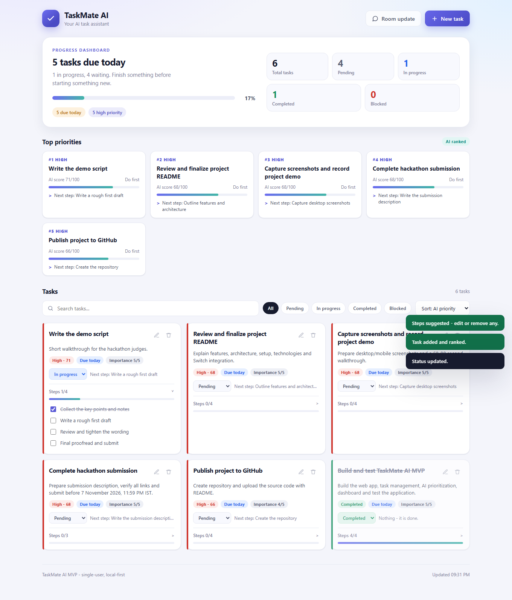

# TaskMate AI

A personal task manager that ranks your work, breaks tasks into small steps, tracks progress, and produces a ready-to-post update for a Switch room.

TaskMate AI runs locally as a single Node.js app. No build step, no login, no external API keys, and no trained machine-learning model.



---

## Problem statement

Solo builders working against a deadline do not usually fail because they lack a to-do list. They fail because the list has no order, the tasks are too large to start, and there is no quick way to report where things stand.

TaskMate AI addresses three concrete problems:

1. **No clear order.** Everything looks equally urgent, so the important work slips.
2. **Tasks too large to start.** "Finish the project" is not an actionable item.
3. **Status is invisible.** Progress lives in your head, not somewhere you can review or share.

The app solves these with a deterministic priority score, automatic step suggestions, four explicit statuses, and a one-click summary for the team chat.

---

## Overview

- Enter a task with a title, due date, importance (1-5) and effort (S/M/L).
- TaskMate AI scores every task from 0-100 and labels it High, Medium or Low, with a one-line reason.
- New tasks are split into 3-5 actionable steps that can be edited, ticked off or regenerated.
- Tasks move through **Pending → In Progress → Completed**, or **Blocked** with a reason.
- A dashboard shows totals, completion rate, overdue and due-today counts, and the top-ranked work.
- A **Room update** button produces a Markdown summary ready to paste into Mattermost or a Switch room.

The five hackathon tasks ship as sample data, so the board is populated on first run.

---

## Features

| Area | What it does |
| --- | --- |
| Task management | Create, edit, delete, search, filter by status, and sort tasks |
| Priority scoring | 0-100 score, High/Medium/Low level, and a short reason per task |
| Step breakdown | 3-5 suggested steps per task from a template library, fully editable |
| Statuses | Pending, In Progress, Completed, Blocked (with a required-style reason) |
| Step progress | Tick steps to drive a per-task progress bar |
| Dashboard | Totals per status, completion percentage, overdue, due today, high priority |
| Top priorities | The five highest-scoring active tasks, with their next action |
| Room update | Markdown digest of counts, progress, top priorities and blocked items |
| Next action | Each task recommends its next concrete move (next open step, unblock, start now) |
| Responsive UI | Works at desktop and phone widths |

What the app deliberately does **not** include: accounts, multi-user sync, notifications, a database server, or an LLM.

---

## How prioritisation and task breakdown actually work

**This is rule-based logic, not a trained AI model.** There is no model file, no training data, no API call, and no vendor dependency. The behaviour is deterministic: the same task produces the same score and the same suggested steps every time, and it works offline.

### Priority score

| Factor | Points |
| --- | --- |
| No deadline | +4 |
| Overdue | +42 |
| Due today | +36 |
| Due tomorrow | +30 |
| Due within 3 days | +23 |
| Due within 7 days | +15 |
| Due within 14 days | +8 |
| Due later | +3 |
| Importance (1-5) | (importance - 1) × 7, so 0 to +28 |
| Effort S | +5 (quick win) |
| Effort L | -3 |
| Status Blocked | +8 |
| Status In Progress | +4 |
| Unfinished steps | Up to +4, proportional to remaining steps |
| Age | +1 per day since creation, capped at +8 |

The total is clamped to 0-100. **65+ is High, 45-64 is Medium, below 45 is Low.** Completed tasks are excluded from ranking and score 0.

### Step breakdown

Step generation matches the task title and description against a small template library:

- writing (`write`, `readme`, `report`, `draft`, `submit`, ...)
- building (`build`, `code`, `feature`, `fix`, `test`, `deploy`, ...)
- learning (`learn`, `study`, `research`, `practice`, ...)
- applying (`apply`, `form`, `register`, `interview`, ...)
- planning (`plan`, `schedule`, `review`, `prepare`, ...)
- buying (`buy`, `order`, `pay`, ...)
- tidying (`clean`, `organize`, `sort`, ...)

If nothing matches, a generic four-step fallback is used. Small-effort tasks are trimmed to three steps, blocked tasks get an extra "resolve the blocker" step first, and the result is capped at five steps. Every suggested step is editable.

---

## Architecture

```
┌─────────────────────────────┐
│  Browser (single-page UI)   │
│  public/index.html          │
│  public/app.js              │
│  public/styles.css          │
└──────────────┬──────────────┘
               │ fetch (JSON)
┌──────────────▼──────────────┐
│  Express server (server.js) │
│  REST API + static hosting  │
└───────┬──────────────┬──────┘
        │              │
┌───────▼──────┐ ┌─────▼─────────────┐
│ lib/priority │ │ lib/store          │
│ Scoring,     │ │ Validation, ids,   │
│ steps,       │ │ seed data, JSON    │
│ digest       │ │ file persistence   │
└──────────────┘ └─────┬─────────────┘
                       │
                 data/tasks.json
```

- **Presentation layer** — static HTML, CSS and vanilla JavaScript. No framework and no bundler.
- **API layer** — Express routes for tasks, steps, dashboard, digest and health.
- **Domain layer** — `lib/priority.js` computes scores, step suggestions, next actions and the room digest.
- **Persistence layer** — `lib/store.js` validates input, normalises records, and writes `data/tasks.json` atomically (write to a temp file, then rename).
- **Storage** — a plain JSON array. Fine for a single-user demo; not a multi-user database.

Reads and writes are synchronous and the whole file is rewritten on each change, which keeps the demo simple and predictable.

---

## Technology stack

| Layer | Technology | Version / notes |
| --- | --- | --- |
| Runtime | Node.js | 18 or newer; verified on 24.14.0 |
| Web server | Express | ^4.21.2 |
| Frontend | HTML, CSS, vanilla JavaScript | no framework, no build step |
| Storage | JSON file (`data/tasks.json`) | optional override via `TASKMATE_DATA_DIR` |
| API tests | Node `assert` + built-in `fetch` | `test/smoke.js`, no browser needed |
| UI tests | `puppeteer-core` | `test/ui.js`, uses an installed Chrome |
| Collaboration | Switch room + TaskMate AI agent | agent calls the local REST API |

No database, ORM, bundler, CSS framework or cloud service is required.

---

## Installation

**Requirements**

- Node.js 18 or newer (`node -v`)
- npm (ships with Node)
- Chrome, only if you want to run the UI tests

**Steps**

```bash
cd taskmate-ai
npm install
npm start
```

Open **http://127.0.0.1:3000**

The server prints the exact URL on startup. If port 3000 is busy it automatically tries 3001, 3002, and so on, up to ten attempts. Stop it with `Ctrl+C`.

On first run, `data/tasks.json` is created automatically and seeded with the five project tasks.

**Environment variables (all optional)**

| Variable | Default | Purpose |
| --- | --- | --- |
| `PORT` | `3000` | Starting port |
| `HOST` | `127.0.0.1` | Bind address |
| `TASKMATE_DATA_DIR` | `./data` | Where `tasks.json` is stored |

---

## Usage

1. Click **New task**. Add a title, an optional description and due date, set importance (1-5) on the slider, and choose effort (S/M/L).
2. For a new task, leave the steps empty to accept suggestions, or press **Suggest steps** to preview and edit them.
3. Save. The task appears on the board and in **Top priorities**, ranked by its score.
4. Change status from the card: **Pending → In progress → Completed**, or **Blocked** and fill in the reason.
5. Expand a card and tick steps to update its progress bar.
6. Use the search box, status chips and sort menu to narrow the board.
7. Click **Room update** to generate the Markdown digest, then copy it into Mattermost or the Switch room.

**Keyboard and accessibility:** dialogs are real HTML dialogs with labels on inputs; the layout has no horizontal overflow at phone widths.

---

## REST API

Base URL: `http://127.0.0.1:3000/api`

| Method | Path | Purpose |
| --- | --- | --- |
| GET | `/health` | Health check |
| GET | `/tasks?status=&q=&sort=` | List tasks with computed priority (`sort`: `priority`, `due`, `created`, `importance`) |
| POST | `/tasks` | Create a task; auto-suggests steps unless `autoSteps: false` |
| GET | `/tasks/:id` | One task |
| PATCH | `/tasks/:id` | Update any task field |
| DELETE | `/tasks/:id` | Delete a task |
| POST | `/tasks/:id/steps` | Add a step |
| PATCH | `/tasks/:id/steps/:stepId` | Tick or untick a step |
| DELETE | `/tasks/:id/steps/:stepId` | Remove a step |
| POST | `/tasks/:id/steps/suggest` | Regenerate steps (`?mode=append` keeps existing ones) |
| POST | `/suggest-steps` | Suggest steps for an unsaved draft |
| GET | `/dashboard` | Aggregated stats and top priorities |
| GET | `/digest?format=text` | Markdown room update |

Example:

```bash
curl -X POST http://127.0.0.1:3000/api/tasks \
  -H "Content-Type: application/json" \
  -d "{\"title\":\"Write demo script\",\"dueDate\":\"2026-11-08\",\"importance\":5,\"effort\":\"S\"}"
```

Validation: a blank title returns `400`. Unknown task or step ids return `404`. Unknown API routes return a JSON `404`. Request bodies are capped at 256 KB.

---

## Switch and OpenCode integration

Switch and OpenCode are separate from the web app; the app itself is a standalone local service.

**Switch** provides the collaboration layer: the room, message routing, chat history, and storage for shared documents such as `TaskMate-Tracker.md`. It bridges the room to a chat platform (Mattermost in this setup) and delivers `@taskmate-ai` messages to the agent.

**OpenCode** is the agent runtime that runs TaskMate AI. It executes the reasoning and tool calls: reading the room, posting messages, and editing the room document.

Two integration directions are in use:

1. **App → room.** The **Room update** button builds a Markdown digest (counts, completion rate, overdue, due-today, top priorities, blocked items). Copy it into the room, or have the agent post it.
2. **Room → app.** The TaskMate AI agent acts as the front door. A message such as "add a task to write the demo script, due tomorrow, importance 5" is handled by the agent, which calls the local REST API and reports the result back in the room.

The REST API is the boundary. There is **no webhook, bot token, or inbound Switch-to-server push** in this version: the agent makes the calls, which is why the server must be running locally. The demo shows exactly this loop.

---

## Testing

### Results (verified 7 November 2026, Node v24.14.0)

| Suite | Command | Result |
| --- | --- | --- |
| API and business logic | `npm test` | **22 / 22 checks passed** |
| Headless UI end-to-end | `npm run test:ui` | **18 / 18 checks passed** |

`npm test` uses a temporary data directory, so it never touches your real tasks.

### Running the tests

```bash
npm test            # API and business logic; no browser needed

npm start           # in one terminal, leave it running
npm run test:ui     # in a second terminal; needs the app already running on port 3000
```

The UI suite expects the five seed tasks and their starting statuses. If you have already edited your real tasks, run it against a throwaway data directory instead, so your data is not touched:

```bash
$env:TASKMATE_DATA_DIR="$env:TEMP\taskmate-ui-test"   # PowerShell
$env:PORT="3100"
node server.js
# in a second terminal:
$env:BASE_URL="http://127.0.0.1:3100"; npm run test:ui
```

The UI suite drives real Chrome through the full flow: load the page, create a task, suggest steps, save, change status, tick a step, generate the room update, check the mobile layout, delete the task, and assert there are no console errors. It also regenerates the screenshots.

If Chrome lives somewhere else, set `CHROME_PATH`. To point the suite at another server, set `BASE_URL`.

---

## Project structure

```
taskmate-ai/
  server.js              Express app, REST API, static hosting
  package.json
  lib/
    store.js             JSON storage, validation, ids, seed data
    priority.js          Scoring, step suggestions, next actions, digest
  public/
    index.html           Single-page UI
    styles.css           Design system and responsive layout
    app.js               UI state and API calls
  test/
    smoke.js             API and business-logic checks (22)
    ui.js                Headless Chrome end-to-end checks (18)
  data/
    tasks.json           Your tasks (created automatically)
  screenshots/
    desktop.png          Desktop dashboard
    mobile.png           Mobile layout
```

---

## Screenshots

| View | File | Status |
| --- | --- | --- |
| Desktop dashboard | `screenshots/desktop.png` | Included |
| Mobile layout | `screenshots/mobile.png` | Included |
| Room update dialog | `screenshots/room-update.png` | Placeholder - add before submission |
| Blocked task with reason | `screenshots/blocked-task.png` | Placeholder - add before submission |
| Switch room conversation | `screenshots/switch-room.png` | Placeholder - add before submission |
| Demo video | `demo/taskmate-demo.mp4` | Placeholder - record 60-90 seconds |

To add a missing image, save it at the path above, then replace the table row's status with `Included` and embed it:

```markdown

```

---

## Resetting the sample data

Stop the server, delete `data/tasks.json`, then start it again. The five seed tasks are recreated automatically.

---

## Troubleshooting

- **Port already in use** — the server moves to the next free port after ten attempts; check the console for the URL it printed.
- **App looks empty** — confirm you are on the URL printed at startup and that `data/tasks.json` exists.
- **`npm install` fails** — check `node -v` is 18 or newer and that you are online.
- **UI tests skip or fail to launch Chrome** — set `CHROME_PATH` to your Chrome executable, and make sure `npm start` is running first.
- **Changes do not appear** — the API writes the whole JSON file on each change; check the server console for read/write errors.

---

## Limitations and next steps

- Single user, no authentication; intended to run on localhost.
- Prioritisation and step suggestions are rule-based, so they are predictable but not personalised learning.
- Storage is a JSON file rewritten in full per change; fine for a demo, not for concurrency or multi-user use.
- The Switch integration is agent-driven through the REST API; there is no inbound webhook.
- Data is lost if `data/tasks.json` is deleted (that is also how you reset to sample data).
- Possible extensions: optional LLM step generation behind a flag, SQLite storage, a real Mattermost incoming webhook, drag-and-drop ordering, natural-language quick-add.
